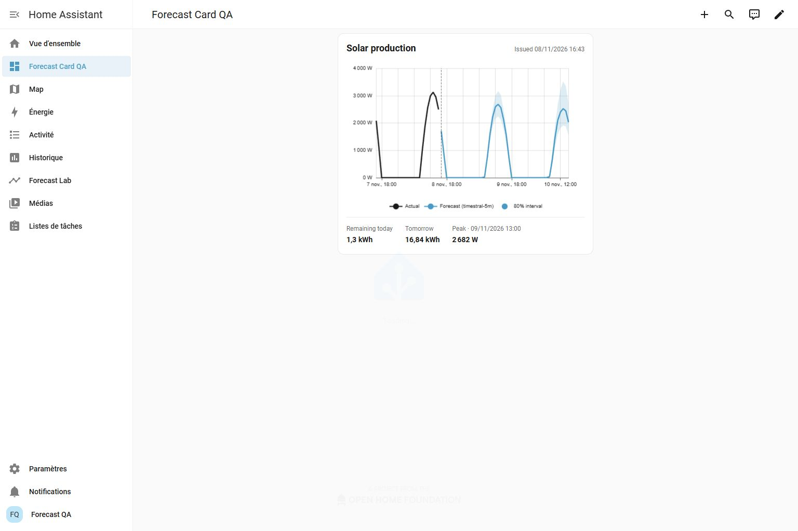

# Local Forecast Card

Plot published forecasts from the [Local Forecast integration](https://github.com/Elijaht-dev/local-forecast) in a Home Assistant dashboard. The card displays measured history, the forecast, an optional uncertainty band, and solar summaries.



## Install the public beta

Use Home Assistant 2026.11 or later. Pair the Local Forecast integration with your engine, open **Forecast Lab**, save a project and select **Publish forecast**. The card reads the project's forecast sensor through Home Assistant. [Integration and engine setup](https://github.com/Elijaht-dev/local-forecast#install-the-public-beta)

1. In **Settings → Marketplace**, add `https://github.com/Elijaht-dev/local-forecast-card` as a custom repository of type **Dashboard**.
2. Open **Local Forecast Card**, enable **Pre-release** and install the beta. Reload your browser. If you manage dashboard resources in YAML, add the module URL shown by the Marketplace.
3. Edit your dashboard, choose **Add card → Local Forecast**, and select the project's forecast sensor in the visual editor.

For a manual install, download `local-forecast-card.js` from the beta release, copy it to `config/www/`, and add `/local/local-forecast-card.js` as a **JavaScript module** under **Settings → Dashboards → Resources**. Restart Home Assistant if you just created `www`, then reload your browser. [Download the beta module](https://github.com/Elijaht-dev/local-forecast-card/releases/download/v0.1.1-beta.1/local-forecast-card.js)

## Configure the card

Choose the history and forecast windows in the visual editor, or use YAML. Replace the example entity with the published forecast sensor from your project.

```yaml
type: custom:local-forecast-card
entity: sensor.solar_production_next_interval
title: Solar production
horizon_hours: 48
history_hours: 24
show_uncertainty: true
show_solar_summary: true
```

## Build

```sh
npm ci
npm run build
```

The build produces `dist/local-forecast-card.js`. Dashboard viewers need read access to the forecast sensor and its measured target. Times use the forecast's configured Home Assistant time zone.

MIT licensed.
